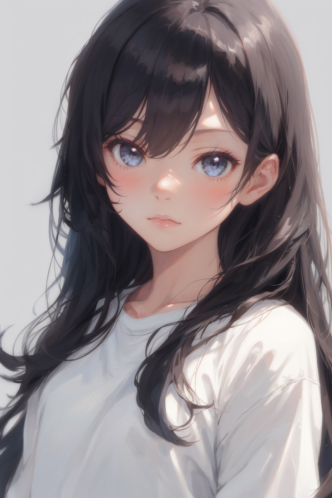
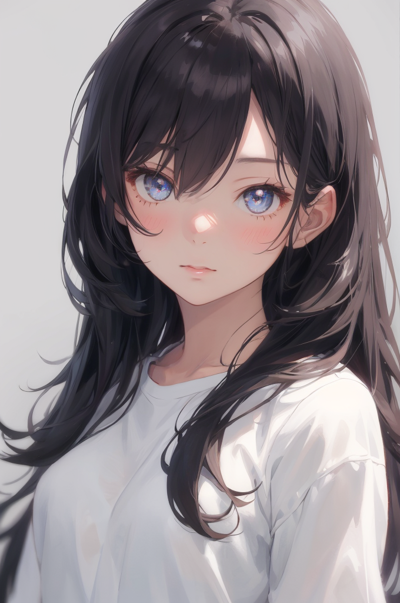
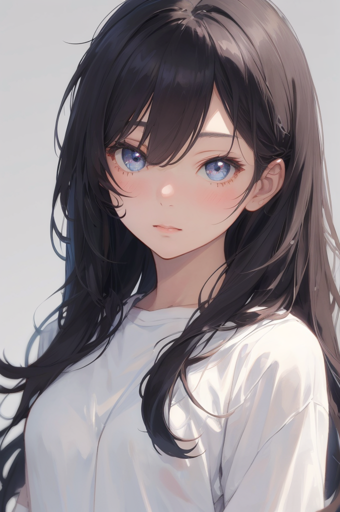

# dsh-image-create · dsh 生图

> 把本机 Stable Diffusion 接进 DSH 对话：**A 档照常出图，C 档只给本地注入命令**，并补齐「拿你自己的图做图生图」+「脸/手质检」的完整链路。
>
> 本仓库是 [dsh-sd-bridge-guard](https://github.com/savinglighting/dsh-sd-bridge-guard)（MIT）的 fork，修掉了 C 档（本地注入）的几个硬伤，详见 [FORK-NOTES.md](FORK-NOTES.md)。


---

## 效果预览

C 档「用自己的图做图生图」——左：你给的底图；右：出的成品（img2img denoising 0.55，比例/画质按底图自动匹配）。

| 底图（输入） | 成品（输出） |
| --- | --- |
|  |  |

多选模式（出满 N 张后弹列表让你挑）：



---

## 这是什么

一个 **DeepSeek Harness 插件**（纯本地运行，不上传任何图片）：

- **A 档**（完全不违规的需求）：聊天里直接出图，按 `sd-paint` 技能规范写提示词、给可复现脚本、出图后自检
- **C 档**（涉及任何违规内容）：**一张图都不生成**，只生成本地 `sd-inject.ps1` 的注入命令；你在本机弹出的参数表单里自己填、自己出图
- 附带一个 **C 档参数表单**（WinForms）和一条 **脸/手质检** 流水线（本地 Ollama + 视觉模型）

## 功能特性

| 能力 | 说明 |
| --- | --- |
| 八件套工具 | `sd_txt2img` / `sd_img2img` / `sd_inpaint` / `sd_script` / `sd_script_b` / `sd_models` / `sd_server` / `sd_inject` |
| `sd-paint` 技能 | 内置提示词规范 + 违规分流协议（A 档 / C 档） |
| C 档参数表单 | 正向/负向提示词、迭代次数、Denoising、比例、画风、画质、LoRA、模型、命名、**底图**、**多选** |
| 用自己的图做图生图 | 表单「底图：浏览…」或 `-InitImage`，自动匹配比例/画质，Denoising 自动抬到 0.55 |
| 脸/手质检 | 本地 Ollama 视觉模型打分（0-100，≥75 过关），不过关换 seed 重试，取最高分那张 |
| 多选模式 | 出满 N 张后弹列表勾选保留（`-PickAll`），取消 = 全部保留 |
| 跨机器 | 自动探测 SD 目录、自动拉起 SD / Ollama、产物落会话工作区 |

## 环境要求

| 项 | 要求 |
| --- | --- |
| 系统 | Windows 10 / 11 |
| PowerShell | 5.1（Windows 自带） |
| 后端 | Stable Diffusion WebUI（A1111），API 端口默认 `7860`；没有可跑 `install-sd.ps1` 一键装 |
| 质检（可选） | Ollama + 视觉模型（推荐 `qwen3-vl:4b`，8G 显存够用）；没装也能出图，只是不质检 |

> 显存参考：8 GB 显卡上，SD 常驻约 2.4 GB，质检模型 4b 约 3.3 GB。**两者同时驻留会互相挤显存，出图会明显变慢**（实测同一张图 10 秒 → 3 分钟），见 FAQ。

---

## 安装

### 方式 A：作为 DSH 插件（推荐）

DSH 从 `~/.dsh/profiles/desktop/node_modules` 加载插件。**同一个工具名不能注册两次**，所以要先备份/移除原插件：

```powershell
$dir = "$env:USERPROFILE\.dsh\profiles\desktop\node_modules"

# 1) 备份原插件（有的话）
if (Test-Path "$dir\dsh-sd-bridge-guard") {
  Move-Item "$dir\dsh-sd-bridge-guard" "$dir\dsh-sd-bridge-guard.bak" -Force
}

# 2) 克隆本仓库（目录名保持与包名一致）
git clone https://github.com/xingqikong/dsh-image-create "$dir\dsh-sd-bridge-guard"
```

然后重启 DSH（或重载插件）。插件自带 `cordis.patch.yml`，`sd_txt2img` 等 8 个工具和 `sd-paint` 技能会自动注册。

### 方式 B：只用脚本（不装插件）

把这三个文件放同一个目录即可：

```
sd-inject.ps1      # C 档本地注入（表单 + 图生图 + 质检）
sd-direct.ps1      # 单次出图（txt2img / img2img / inpaint / 蒙版重绘）
install-ollama.ps1 # 一键装 Ollama + 视觉模型（可选）
```

### 装质检环境（可选）

```powershell
.\install-ollama.ps1                      # 装 Ollama + 拉 qwen3-vl:4b（8G 显存推荐）
.\install-ollama.ps1 -Model qwen3-vl:8b   # 显存大（12G+）可以换 8b
.\install-ollama.ps1 -SkipModel           # 只装 Ollama
```

脚本会自动：检测已装 → 没有就下载安装包（GitHub 慢自动换镜像）→ 静默安装 → 拉起服务 → 拉模型 → 验证 `/v1/models`。重复执行安全。

---

## 快速开始：用自己的图做图生图（C 档）

```powershell
cd <脚本所在目录>
.\sd-inject.ps1 -InitImage "D:\我的图.png"
```

或者在弹出的表单里点最下面 **「底图：浏览…」** 选图（两条路等价）。

跑起来后，控制台应该出现这三行（说明真的读了你的图）：

```
本次用你准备的底图：D:\我的图.png
表单已确认：迭代 3 次 | Denoising 0.55（图生图） | 比例 2:3 | 画质 1024p | … | 底图 你的底图
最终出图走图生图：底图 = 你准备的图，denoising = 0.55
```

选好底图后脚本会自动做 4 件事：

1. **跳过素体自检迭代**（底图已经是你给的，不用再挑）
2. 按你的图自动匹配 **比例**、按短边自动匹配 **画质**
3. Denoising 还是 0（文生图）时**自动抬到 0.55**，避免底图白给
4. 不再强行追加 `full body`（构图由你的图决定）

## 表单字段说明

| 字段 | 说明 |
| --- | --- |
| 正向 / 负向提示词 | 基底已预填，可直接改；末尾逗号自动补齐 |
| 迭代次数 | 出几张（1-32）。质检达标会**提前停**；勾了「多选」则出满 |
| Denoising | `0` = 文生图；`0.3-0.5` 贴底图微调；`≥0.7` 基本重画。可下拉可手填 |
| 比例 / 画质 | 输出尺寸 = 短边档位（480p-2160p）+ 比例；选了底图会自动匹配 |
| 画风 | 切换画风会把对应正/负向画风词写进两个提示词框（可再手改） |
| LoRA / 模型 | 从本机 SD 拉列表；留空 = 不挂 / 用当前模型 |
| 命名 | 留空 = 用提示词总结 + 序号 |
| **底图** | 你的图 → 图生图；留空 = 老流程（素体基底 / 现场补一张） |
| **多选** | 出满 N 张后弹列表勾选保留（默认关：只留最高分那张） |

## 命令行参数（sd-inject.ps1）

| 参数 | 默认 | 说明 |
| --- | --- | --- |
| `-InitImage` | 空 | 自定义底图路径（图生图） |
| `-PickAll` | 关 | 多选模式：出满后弹列表让你挑（表单里对应勾选框） |
| `-NoIterate` | 关 | 跳过素体自检迭代 |
| `-IterateRounds` | 3 | 素体迭代轮数上限 |
| `-VlmModel` | `qwen3-vl:4b` | 质检用的视觉模型（留空 = 自动挑本机 vl/vision 模型） |
| `-QwenBase` | `http://127.0.0.1:11434/v1` | 质检接口（Ollama OpenAI 兼容端点） |
| `-BasePrompt` / `-BaseNegative` | 素体基底 | 表单预填内容 |
| `-Width` / `-Height` / `-Steps` / `-Cfg` / `-Sampler` / `-Seed` | 512 / 768 / 24 / 7 / DPM++ 2M / -1 | 出图参数 |
| `-OutDir` / `-Name` | 脚本目录\SD-Picture / inject | 产物目录 / 文件名前缀 |
| `-SdDirect` / `-SdDir` / `-SdPort` | 脚本同目录 / 自动探测 / 7860 | SD 相关路径与端口 |
| `-NoOpen` | 关 | 跑完不自动打开图片 |

示例：

```powershell
# 拿自己的图重绘（0.45 更贴原图）
.\sd-inject.ps1 -InitImage "D:\a.png" -NoIterate

# 出 4 张，最后弹列表让我挑
.\sd-inject.ps1 -InitImage "D:\a.png" -PickAll

# 换大模型做质检
.\sd-inject.ps1 -VlmModel qwen3-vl:8b
```

## 质检（脸 / 手）

- 每张图发给本地视觉模型，只问两件事：**脸部**（对称、五官、畸形）、**手部**（五指是否齐全、多指/少指/粘连）
- 返回 0-100 分，`≥75` 过关；不过关会换 seed 继续，直到迭代次数上限，取最高分那张
- 质检服务没起时脚本会自己拉起来（`Start-OllamaIfNeeded`）；实在起不来会**出满 N 张 + 弹列表让你自选**，不会静默跳过
- 质检只评结构分，不做内容审查

---

## 相对上游的修复（本 fork 的核心）

详见 [FORK-NOTES.md](FORK-NOTES.md)，摘要：

| # | 问题 | 修复 |
| --- | --- | --- |
| 1 | Denoising 选了 >0 却"回到 0"（无底图时静默退回文生图） | 无底图时现场补一张素体底图（`Invoke-BaseOnce`），保证一定走图生图 |
| 2 | C 档表单没有底图入口 | 新增「底图：浏览…」+ `-InitImage`，自动匹配比例/画质、自动抬 Denoising |
| 3 | SD 冷启动时脚本卡死在预热（表单永不弹出） | 预热改为不捕获子进程输出（管道继承导致死等 EOF） |
| 4 | 没有"出几张让我挑" | 新增 `-PickAll` / 表单勾选框（配合 `-ForceAll` 不提前停） |
| 5 | 装了 Ollama 但服务没起 → 质检失效 | `Start-OllamaIfNeeded` 自动拉起 |
| 6 | 默认 8b 质检模型在 8G 显存上抢显存 | 默认改 `qwen3-vl:4b` |
| 7 | 参数解析太脆（全角数字、"8 轮"、中文逗号） | 归一化 + 容错，非法输入给提示 |
| 8 | 选错参数要等几分钟才知道 | 表单确定后立即回显实际取到的参数 |
| 9 | 有底图时仍强行追加 `full body` | 有底图就不追加，构图交给底图 |

## 常见问题（FAQ）

**Q：出了图但没弹列表？**
列表只在两个情况下出现：质检模型不可用（兜底），或你在表单里勾了「多选」/ 传了 `-PickAll`。质检正常时默认只留最高分那张。

**Q：出图特别慢（一张几分钟）？**
多半是质检模型和 SD 同时占显存。8G 卡上：SD ≈2.4G + 4b 视觉模型 ≈3.3G，SD 会被挤到共享显存。可选方案：换 `qwen3-vl:2b`；或出图时先让模型卸载；或先出满 N 张再统一质检。

**Q：底图选了但输出跟图无关？**
看控制台是否有 `最终出图走图生图：底图 = 你准备的图`。如果写的是「素体基底」，说明底图没读到（路径不存在会打印 `底图不存在：…`）。

**Q：脚本里的中文变乱码、直接语法报错？**
PowerShell 5.1 需要 **UTF-8 with BOM**。用编辑器保存时选 "UTF-8 with BOM"。

**Q：插件更新后我的修改没了？**
`sd-inject.ps1` 由插件在每次调用时同步到工作区（内容不同就覆盖）。本仓库已经把改动做进包里；如果你又本地改过，可以用 `tools/apply-fix.ps1` 重打补丁，或直接在本仓库上改。

**Q：为什么仓库名不叫「dsh生图」？**
GitHub 仓库名只允许 ASCII（字母/数字/`-_.`），本仓库用 `dsh-image-create`，中文名放在简介里。

## 目录结构

```
sd-bridge.js          # 插件主程序（8 个工具 + sd-paint 技能 + C 档命令生成）
sd-inject.ps1         # C 档本地注入：参数表单 + 素体迭代 + 图生图 + 脸/手质检
sd-direct.ps1         # 单次出图（txt2img / img2img / inpaint / 蒙版重绘）
install-sd.ps1        # SD WebUI 一键安装
install-ollama.ps1    # Ollama + 视觉模型一键安装（质检用）
cordis.patch.yml      # DSH 插件注册补丁
tools/apply-fix.ps1   # 把本仓库的修复重新打进任意一份 sd-inject.ps1
docs/                 # 上游文档与演示图
```

## 许可与致谢

- 本仓库基于 [savinglighting/dsh-sd-bridge-guard](https://github.com/savinglighting/dsh-sd-bridge-guard)（MIT）修改，**保留原版权声明与许可文本**。
- 原作品：Copyright (c) 2026 dsh-sd-bridge-guard contributors
- 本 fork 的修改部分：Copyright (c) 2026 xingqikong
- 以 MIT 协议发布，详见 [LICENSE](LICENSE)。

> 说明：本 fork 与上游作者无隶属关系；MIT 不授予商标权，请勿用原作者/上游项目名做背书。
